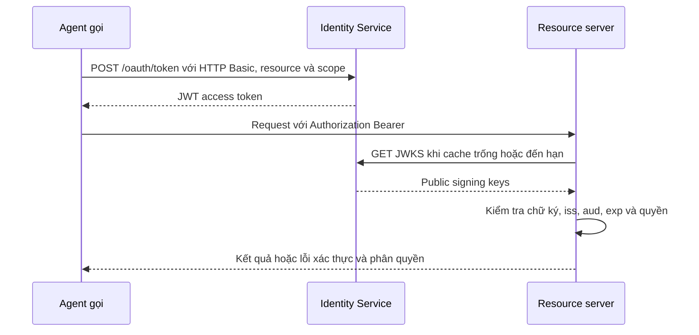

# Kiến trúc Authentication cho Distributed Agent Network

Trạng thái **base độc lập**. Identity và Task API mẫu đã chạy qua HTTP. Phần tích hợp dưới đây là phương án để Trường Sơn review với Instructor và các nhóm sau buổi demo.

## Thành phần và ranh giới tin cậy

| Thành phần | Trách nhiệm |
|---|---|
| Identity Service | Xác thực OAuth client, cấp access token ngắn hạn theo resource và scope được gán, công bố metadata và public keys. Chỉ Identity giữ khóa ký. |
| Agent gọi | Giữ client credential của chính nó, lấy token từ issuer đã cấu hình, dùng token với service đúng audience. |
| Resource server | Xác minh JWT bằng JWKS từ nguồn đã cấu hình, rồi quyết định theo action và tài nguyên. Danh tính lấy từ claim đã xác minh. |
| Registry | Giữ Agent Card, capability, endpoint, heartbeat và lease. Quyết định ownership nằm ở Registry. |
| Broker | Giữ, định tuyến và giao message. Khi tích hợp, Broker phải quyết định quyền đối với thao tác gửi, nhận và ACK trước khi đổi trạng thái giao tin. |
| Observability | Nhận sự kiện có actor, action, kết quả, `trace_id` và `message_id` khi có. Credential và bearer token được loại khỏi sự kiện. |

Base hiện có [Identity](../agent_auth/identity.py), [validator và Task API](../agent_auth/resource.py), [lệnh chạy riêng từng dịch vụ](../agent_auth/local.py) và [demo](../agent_auth/demo.py). Demo dùng hai listener trong cùng tiến trình. Khi phát triển có thể chạy hai dịch vụ ở hai tiến trình độc lập. Trường `from` trong body là dữ liệu ứng dụng. Task API trả actor từ `sub` đã xác minh.

## Hợp đồng base hiện hành

| Giao diện | Hợp đồng |
|---|---|
| `GET /.well-known/oauth-authorization-server` | Trả issuer, token endpoint, JWKS URI, grant và client authentication method. Issuer được cấu hình trước ở client. So khớp issuer chính xác khi dùng discovery. |
| `GET /.well-known/jwks.json` | Tập khóa công khai gồm RSA key có `kid`, `alg=RS256` và `use=sig`. |
| `POST /oauth/token` | `client_secret_basic`, form gồm `grant_type=client_credentials`, một `resource` và `scope` phân cách bằng dấu cách. Từ chối quyền ngoài policy. Trả `access_token`, `token_type`, `expires_in`, `scope`. |
| JWT | `typ=at+jwt`, `alg=RS256`, `kid`. Claims bắt buộc `iss`, `sub`, `aud`, `client_id`, `scope`, `iat`, `exp`, `jti`. Base ánh xạ `sub = client_id` và phát một audience khớp chính xác `resource`. |
| `POST /tasks` | Bắt buộc token có scope `task:issue`. Trả `200` cùng actor nếu hợp lệ, `401` nếu thiếu hoặc sai token, `403` nếu thiếu scope, `503` nếu cần làm mới JWKS mà nguồn khóa không dùng được. |

Resource server giữ cache JWKS 60 giây. `kid` chưa biết được từ chối trong thời gian cache còn hiệu lực. Đến hạn cache thì dịch vụ làm mới khóa và từ chối phục vụ request được bảo vệ nếu tải khóa thất bại. Token còn hạn và dùng khóa đã cache vẫn dùng được trước khi cache hết hạn. Base chưa có luồng rotate, lưu danh tính qua lần restart, revoke JWT tức thời, hay policy theo từng bản ghi. [RFC 8414](https://www.rfc-editor.org/rfc/rfc8414.html) · [RFC 8707](https://www.rfc-editor.org/rfc/rfc8707.html) · [RFC 9068](https://www.rfc-editor.org/rfc/rfc9068.html) · [RFC 6750](https://www.rfc-editor.org/rfc/rfc6750.html)

## Phương án đưa ra review

| Quyết định | Phương án đề xuất và câu hỏi cần chốt |
|---|---|
| Nghiệm thu qua Broker | Đề xuất gửi công việc giữa hai agent qua Broker. A xin token cho Broker và tra agent đích qua Registry. Broker kiểm tra quyền gửi. Cần xác nhận cơ chế giao tin thực tế và giới hạn của yêu cầu dùng Broker với Instructor. |
| Nếu Broker dùng pull | B dùng token riêng cho Broker để nhận và ACK. Đề xuất Broker đối chiếu mỗi thao tác với danh tính đã xác thực và gắn danh tính người gửi vào tin. Cần chốt định dạng, nguồn tin cậy và quyền cho từng thao tác với nhóm Broker. |
| Registry | Đề xuất xác thực JWT trước các thao tác ghi mới, áp ownership theo binding từ `sub` tới `agent_id`, rồi quyết định lộ trình chuyển card cũ. Cần chốt endpoint đọc nào giữ public và cách gắn chủ card đã tồn tại. |
| Danh tính và thu hồi | Đề xuất mỗi agent có credential riêng và access token ngắn hạn. Cần chốt thu hồi có hiệu lực tại lần cấp tiếp theo hay phải chặn token đang lưu hành ngay. |
| Giao thức và triển khai | HTTP/JSON qua HTTPS cho môi trường chung. Python là runtime base. Broker Go dùng hợp đồng HTTP/JWT và bộ kiểm chứng chung. Cần chốt issuer HTTPS, hostname, nơi lưu khóa, đầu mối vận hành và thu thập trace trên IRIS. |

Trước khi tích hợp thật, ghi từng quyết định vào PR cập nhật tài liệu kèm nhóm đã xác nhận, endpoint/audience/scope, điều kiện nghiệm thu và hành vi chuyển đổi. Xem [audit repo](integration-audit.md) và [spec bàn giao](handoff.md).
