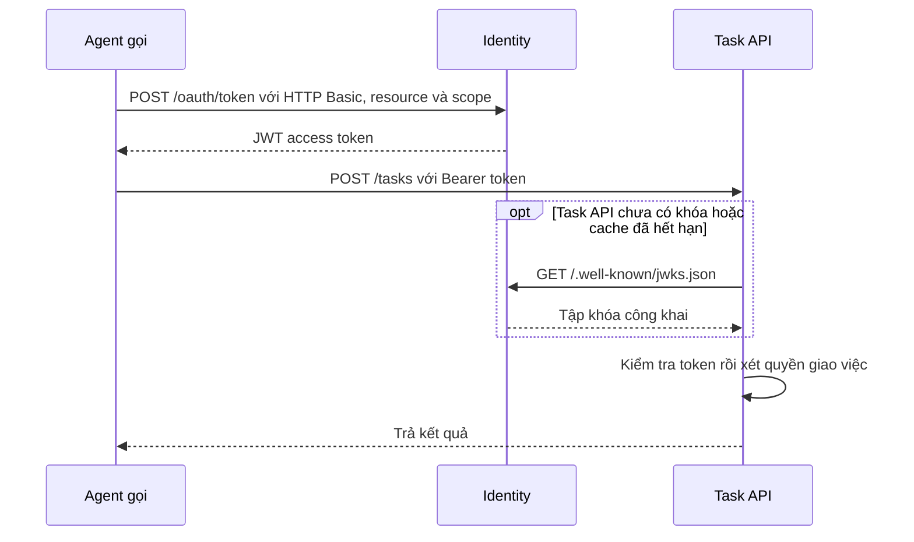

# Kiến trúc xác thực và phân quyền

Bản hiện tại chạy được Identity và Task API mẫu qua HTTP trên máy. Ta dùng hai dịch vụ này để kiểm tra cách cấp token và xét quyền trước khi nối với Broker, Registry và các agent của nhóm khác.

## Agent xin token rồi gọi API thế nào?

Agent đã có client ID và secret riêng. Khi cần giao việc qua Task API, agent xin token cho đúng dịch vụ và quyền cần dùng. Identity kiểm tra secret và quyền đã cấp trước khi ký token. Task API lấy khóa công khai từ JWKS để kiểm tra chữ ký, rồi xem token có dành cho mình và có quyền `task:issue` hay không. Nếu yêu cầu có trường `from`, Task API vẫn dùng `sub` đã xác minh để xác định người gọi.

Mã nguồn gồm [Identity](../agent_auth/identity.py), [trình xác minh token và Task API](../agent_auth/resource.py), [lệnh chạy từng dịch vụ](../agent_auth/local.py) và [demo](../agent_auth/demo.py). Demo mở hai cổng trong cùng một tiến trình. Lệnh chạy từng dịch vụ cho phép khởi động Identity và Task API ở hai tiến trình khác nhau.

## Hợp đồng HTTP đang dùng

| Giao diện | Dữ liệu gửi và nhận |
|---|---|
| `GET /.well-known/oauth-authorization-server` | Công bố `issuer`, địa chỉ cấp token, địa chỉ JWKS, grant và cách xác thực client. Client biết trước issuer nào được tin cậy và kiểm tra issuer trong metadata có khớp chính xác hay không. |
| `GET /.well-known/jwks.json` | Trả tập khóa RSA công khai. Mỗi khóa có `kid`, `alg=RS256` và `use=sig`. |
| `POST /oauth/token` | Dùng `client_secret_basic` và form có `grant_type=client_credentials`, một `resource` và các `scope` phân cách bằng dấu cách. Identity từ chối quyền ngoài phạm vi đã cấp. Phản hồi thành công gồm `access_token`, `token_type`, `expires_in` và `scope`. |
| JWT | Header có `typ=at+jwt`, `alg=RS256` và `kid`. Claims gồm `iss`, `sub`, `aud`, `client_id`, `scope`, `iat`, `exp` và `jti`. Bản hiện tại dùng `sub = client_id` và cấp một `aud` khớp chính xác `resource`. |
| `POST /tasks` | Yêu cầu `Authorization: Bearer <token>` và scope `task:issue`. Khi được phép, API trả `200` và danh tính từ token. |

| Tình huống ở Task API | Phản hồi |
|---|---|
| Thiếu token, token sai hoặc hết hạn | `401` |
| Token hợp lệ nhưng thiếu quyền `task:issue` | `403 insufficient_scope` |
| API phải tải lại JWKS nhưng không lấy được khóa | `503 temporarily_unavailable` |

Task API giữ JWKS trong 60 giây. Trong khoảng đó, API vẫn kiểm tra được token còn hạn bằng khóa đã lưu và từ chối token có `kid` lạ. Đến hạn, API thử tải khóa lại. Nếu không tải được, API từ chối xử lý yêu cầu cần xác thực và trả `503`. Lưu danh tính qua lần khởi động lại, xoay khóa, thu hồi JWT trước hạn và xét quyền trên từng bản ghi thuộc phần phát triển tiếp theo. [RFC 6749 §4.4](https://www.rfc-editor.org/rfc/rfc6749.html#section-4.4) · [RFC 8414](https://www.rfc-editor.org/rfc/rfc8414.html) · [RFC 8707](https://www.rfc-editor.org/rfc/rfc8707.html) · [RFC 9068](https://www.rfc-editor.org/rfc/rfc9068.html) · [RFC 6750](https://www.rfc-editor.org/rfc/rfc6750.html)

## Khi ghép với các nhóm khác

**Ai cấp quyền và ai xét quyền?** Đề xuất chủ API định nghĩa scope cho từng thao tác. Identity quản lý quyền đã cấp cho agent theo vai trò hoặc nhóm. Khi nhận yêu cầu, dịch vụ kiểm tra scope và xét tiếp quyền trên dữ liệu của mình. Chẳng hạn, Registry cần xác định agent đang gọi có phải chủ Agent Card hay không, kể cả khi token có quyền cập nhật.

**Ca nghiệm thu đi qua đâu?** Đề xuất A tìm agent đích qua Registry và gửi công việc qua Broker. A xin token có audience của Broker. Broker kiểm tra quyền gửi trước khi nhận tin. Nếu Broker dùng pull, B dùng token riêng để lấy tin và ACK. Nhóm Broker cần xác nhận cơ chế giao tin, cách kiểm tra người nhận và cách chuyển danh tính người gửi đã xác minh cho B. Cùng Instructor chốt yêu cầu dùng Broker ngoài ca demo. [Đối chiếu mã nguồn](integration-audit.md)

**Registry sẽ chuyển từ credential hiện tại thế nào?** Chốt cách liên kết `sub` với `agent_id` và chủ Agent Card, API nào cần kiểm tra JWT, API đọc nào giữ công khai và cách tiếp tục quản lý các card đã đăng ký. Nhóm Registry giữ quyền quyết định trên bản ghi và lease của mình. [Đối chiếu mã nguồn](integration-audit.md)

**Nếu tắt quyền trong khi token còn hạn thì sao?** Khi cấp token mới, Identity áp dụng quyền mới. Dịch vụ tự xác minh JWT có thể vẫn chấp nhận token cũ đến khi hết hạn. Cần thống nhất thao tác nào phải chặn sớm và thời gian chấp nhận được để quyết định có đưa thêm cơ chế thu hồi vào hay không.

**Môi trường thử chung cần gì?** Dùng HTTP/JSON qua HTTPS. Python là runtime của bản mẫu, còn Broker Go có thể dùng chung hợp đồng HTTP/JWT và bộ ca kiểm thử. Trước khi lên IRIS, thống nhất hostname của issuer, nơi giữ khóa, cách giao secret và người theo dõi vận hành. Observability nối các sự kiện bằng `trace_id` và `message_id` khi có, đồng thời ghi danh tính đã xác minh, thao tác và kết quả. Giữ secret và token ngoài log.

Khi chốt một điểm với nhóm khác, ghi vào PR tên người xác nhận, endpoint, audience, scope, cách kiểm thử và cách chuyển đổi nếu hệ thống đã có client cũ. [Phân công và checklist](handoff.md)
